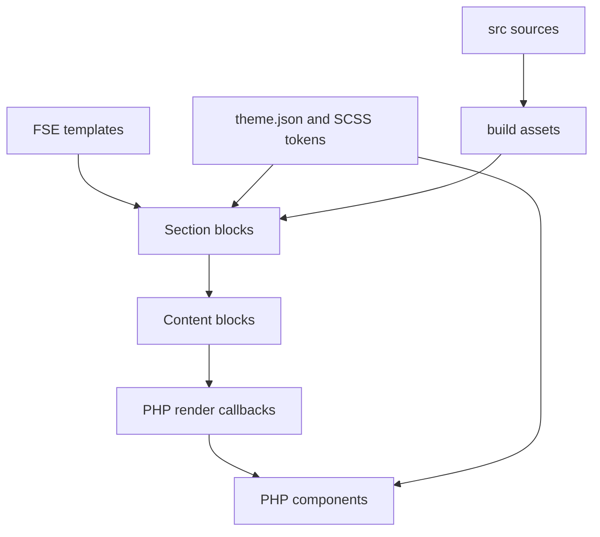

# Architecture

## Purpose

JMC Custom Theme is a Full Site Editing theme with a small WordPress bootstrap, dynamic custom blocks, reusable PHP view components, and shared design tokens for the editor and frontend.

## Runtime flow

## Responsibilities

### Bootstrap and modules

`functions.php` wires together focused modules and helpers:

- `inc/setup.php` declares theme support and editor styles.
- `inc/enqueue.php` loads the compiled shared stylesheet when it exists and uses its modification time for cache busting. It also prints the cascade-layer order (see Styling and tokens) at the top of the frontend `<head>` and as a dependency of the shared stylesheet in the editor.
- `inc/blocks.php` recursively registers compiled block metadata, registers the section category, and applies the current editor allowlist.
- `inc/contact.php` registers the site-wide business settings (name, address, phone, WhatsApp, email, opening hours, service area) and the **Settings → Business** admin page that edits them (`manage_options` only), and copies the footer's legacy block attributes into them once (see [Business contact settings](blocks.md#business-contact-settings)).
- `inc/icons.php` registers the theme's `jmc` icon collection with the core icon registry: the Lucide icons and Simple Icons brand logos generated at build time (see [Icons](blocks.md#icons)).
- `inc/services.php` enables page excerpts, registers the Services page setting and the `jmc_service_icon` page meta, and loads the service icon editor panel (see [Services grid](blocks.md#services-grid)).
- `inc/helpers/` contains reusable framework-level PHP helpers.

Feature logic should not accumulate in the bootstrap.

### Blocks

Source metadata and editor code live in `src/blocks/content/`, `src/blocks/layouts/`, and `src/blocks/site/`; production compilation writes to `build/js/blocks/`. Registration scans each compiled directory containing `block.json`.

The current library contains seventeen dynamic blocks:

- Four insertable sections: `cta-banner`, `hero`, `service-grid`, and `text-with-image`.
- Seven composition blocks: `button`, `buttons`, `column`, `contact-details`, `heading`, `paragraph`, and `service-list`.
- Six site-chrome blocks used in template parts: `navigation` and `header-cta` in the header; `footer`, `footer-business`, `footer-navigation`, and `footer-legal` in the footer.

Editor code that is not tied to one block lives in `src/editor/`, with its own entry in `webpack.config.js`; it currently holds the service icon panel.

Attributes crossing from the editor into PHP are untrusted. Render code must validate allowlisted values, escape at the final boundary, and avoid meaningless empty markup.

### Components and helpers

`jmc_component()` resolves names beneath `components/` and delegates to WordPress template-part loading. Components own reusable markup; blocks own Gutenberg attributes, context, and composition. For example, `components/link-list.php` renders the link list, with `aria-current` on the current page, for both `footer-navigation` and `footer-legal`, each passing its own BEM block class.

`inc/navigation.php` registers the theme's navigation menus by slug and creates any that are missing; see [Navigation menus](blocks.md#navigation-menus).

Use the typed argument helpers in `inc/helpers/component-args.php` and escaped HTML-attribute helpers in `inc/helpers/html/attributes.php`. Do not concatenate raw attributes into markup. `href` values are escaped with `jmc_esc_href()` (`inc/helpers/link.php`), which is `esc_url()` except that it keeps encoded line breaks in pre-filled email and WhatsApp messages (see [Link escaping](blocks.md#link-escaping)).

Shared editor code lives in `src/components/` and `src/utils/`: for example `SiteSetting` reads and edits a site option from a block, with a notice for users who cannot manage options; `ContactSettings` is the **Business details** sidebar panel shared by the Contact Details and footer business blocks; `useThemeIcons()` fetches the registered `jmc` icons so editor previews match `wp_get_icon()`; and `WhatsAppIcon` supplies the WhatsApp logo for editor UI.

### Styling and tokens

`theme.json` exposes WordPress-facing colour, typography, spacing, radius, and layout primitives. SCSS maps them into semantic roles, palettes, layouts, components, and block rules. Frontend and editor entry points share the same foundations.

All theme CSS lives in cascade layers. Their order has one source of truth, `src/scss/layers/index.scss`, which is compiled to `build/css/layers.css` and printed inline as `jmc-layers` before any other stylesheet. Layer priority is fixed by the first stylesheet that mentions each layer, and WordPress prints block styles before the shared stylesheet, so this keeps the order independent of which blocks are on a page. Block stylesheets therefore do not declare the order themselves.

### Build and package

`src/` is the source of truth. `npm run build` creates runtime assets under `build/`. `npm run package` recreates `dist/` with runtime PHP, templates, components, configuration, and compiled assets. CI verifies the package structure, but clean WordPress installation/activation remains planned release-hardening work.

## Dependency rules

1. `functions.php` may depend on `inc/`; feature logic stays out of the bootstrap.
2. Blocks may use components and helpers.
3. Components may use helpers but must not depend on a specific block.
4. Helpers must not render a specific feature.
5. Generated files must never become the source of truth.
6. Presentation variants use allowlists and semantic class names.

## Naming

- PHP functions: `jmc_` prefix and `snake_case`.
- Blocks: `jmc/<name>`.
- CSS classes: `jmc-` prefix with BEM-style elements where useful.
- Text domain: `jmc-theme` in PHP, TypeScript, and block metadata.

The `style.css` header currently uses `jmc-custom-theme`; align it before release.

## Known constraints

- The global block allowlist exposes only `jmc/` blocks and must become context-aware before header, navigation, query, and broader FSE workflows are completed.
- Some internal block metadata still uses legacy, unregistered categories.
- TypeScript strict mode is disabled and existing contracts contain weak typing.
- Header and footer template parts exist; patterns and full template coverage are not implemented.
- Automated behavioural and accessibility tests are not configured.
- Packaging uses Unix-specific shell tools and is not clean-install tested.
- Production hosting, deployment, health-check, and rollback commands are undecided.

Track architectural changes through focused issues. Add short decision records under `docs/adr/` when a decision materially affects multiple blocks, workflows, or future maintainers.
